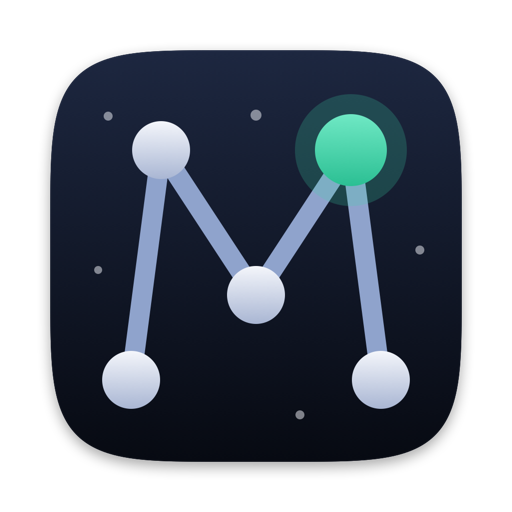
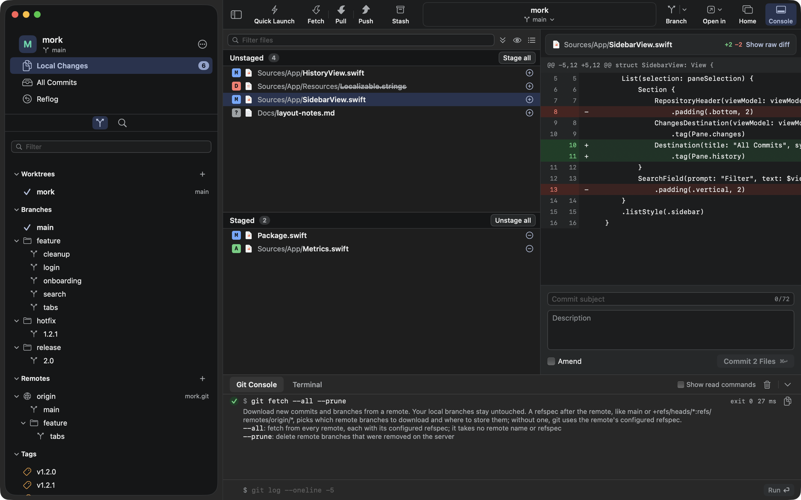
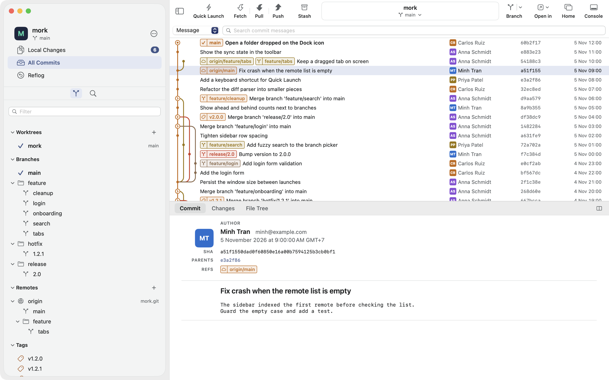
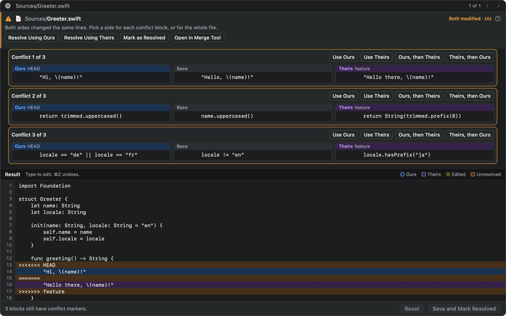
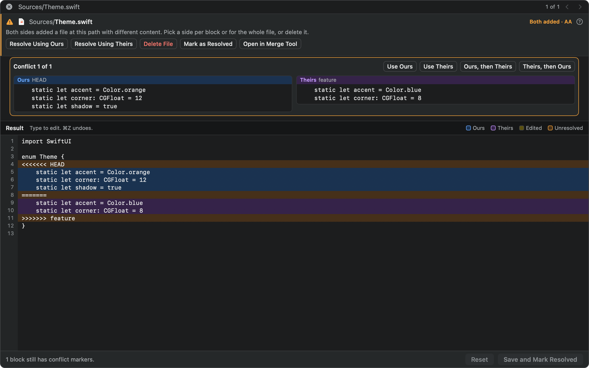
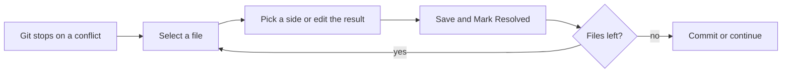

<div align="center">



# Mork

**A native Git client for macOS that teaches you Git as you use it.**

Click as usual. Mork shows the real `git` command, its output and a short lesson.


</div>



## Why Mork

- **Learn by doing.** Every click runs plain `git`. The Git Console shows the command, the result and what each flag means.
- **Nothing hidden.** Mork has no Git engine of its own. You can repeat every action in a terminal.
- **See before you run.** Dialogs show the exact command their button will run.
- **Fast on big repositories.** Mork opens 50,000 commits in under a second.



## What it does

| | |
|---|---|
| **Changes** | Stage, unstage or discard a file, folder, hunk or single line. See image diffs. Commit, amend and sign commits. |
| **History** | Browse the commit graph, search commits, and see file history, line history, blame and reflog. |
| **Branches** | Create, merge, rebase, cherry-pick, revert and reset. Reorder or squash commits with interactive rebase. |
| **Remotes** | Fetch, pull and push. Manage remotes and upstreams. Turn on auto-fetch. |
| **Tags** | Create, push and delete tags. |
| **Conflicts** | Fix conflicts inside the app, or open your own merge tool. |
| **Windows and tabs** | Open several windows and tabs. Save sets of tabs as workspaces. Jump anywhere with Quick Launch. |
| **Tools** | Bisect, statistics, file size treemap, Git Flow, Git LFS, custom commands and a built-in terminal. |
| **Accounts** | Keep GitHub, GitLab, Bitbucket and Gitea tokens in the Keychain. Clone from your account and manage SSH keys. |

## Fixing conflicts

Mork chooses the layout for you.

**3-way:** both sides changed the same lines. Base shows the text before either change.



**2-way:** both sides added the file, so there is no Base.





Press Space on a conflicted file to open the larger window. Deleted and binary files have no blocks, so you choose a side for the whole file.

## Download

**[Download Mork for macOS (Apple silicon)](https://github.com/mantrandev/Mork/releases/latest/download/Mork.zip)**. You need macOS 14 or later and `git`. See what changed in [CHANGELOG.md](CHANGELOG.md).

1. Unzip `Mork.zip` and move `Mork.app` to `/Applications`.
2. Mork is not notarized yet, so macOS blocks the first launch. Run this once in Terminal, then open Mork:

   ```bash
   xattr -dr com.apple.quarantine /Applications/Mork.app
   ```

   Or open Mork once, then click **Open Anyway** in System Settings ▸ Privacy & Security.
3. To use the `mork` command, open Settings ▸ General ▸ Command line tool and click Install.

## Build from source

You need macOS 14 or later, Swift 6 (Xcode 16 or later) and `git`.

```bash
git clone https://github.com/mantrandev/Mork.git mork
cd mork
scripts/build-app.sh --install && open /Applications/Mork.app
```

`--install` replaces `/Applications/Mork.app` and links the `mork` command. Without it, the app stays in `build/Mork.app`.

Run from source:

```bash
swift run Mork --repo="$HOME/path/to/repo"
```

Open in Xcode:

```bash
brew install xcodegen
xcodegen generate && open Mork.xcodeproj
```

Pick the **MorkApp** scheme. On the first build, click the "Validate plug-in" error and choose **Trust & Enable**.

DEV and normal builds can run side by side. Each has its own data.

| | DEV | Normal |
|---|---|---|
| Build | `scripts/build-app.sh --dev --install` | `scripts/build-app.sh --install` |
| App | `/Applications/Mork-DEV.app` | `/Applications/Mork.app` |
| Command | `mork-dev` | `mork` |
| Bundle id | `dev.mantrandev.mork.dev` | `dev.mantrandev.mork` |
| Data | `~/Library/Application Support/mork-dev` | `~/Library/Application Support/mork` |

## Open a repository from the terminal

```bash
mork                     # the repository of this folder
mork ~/code/api          # the repository of that folder
mork Sources/App.swift   # the repository of that file
```

You can also drop a folder on Mork in the Dock.

## Keyboard shortcuts

| Action | Keys | Action | Keys |
|---|---|---|---|
| New window | ⌘N | Commit | ⌘↩ |
| New tab | ⌘T | Find commits | ⌘F |
| Restore closed tab | ⇧⌘T | Changes / All Commits / Reflog | ⌥⌘1 / ⌥⌘2 / ⌥⌘3 |
| Open repository | ⌘O | Refresh | ⌘R |
| Clone | ⇧⌘N | Git Console | ⇧⌘C |
| Quick Launch | ⌘P | Terminal tab | ⌥⌘T |
| Fetch | ⇧⌘F | New branch | ⇧⌘B |
| Pull / Quick Pull | ⇧⌘L / ⌥⇧⌘L | New tag | ⇧⌘G |
| Push / Quick Push | ⇧⌘P / ⌥⇧⌘P | Save stash | ⇧⌘S |
| Close tab / Close window | ⌘W / ⇧⌘W | Next / previous tab | ⌃⇥ / ⌃⇧⇥ |
| Preview a file | Space | Close preview | Space / Esc |
| Stage or unstage selected files | Return | Discard selected files | ⇧⌘D |

## Support Mork

Mork is free. If it helps you, you can [buy me a coffee on PayPal](https://www.paypal.com/donate/?business=tranman131%40gmail.com&currency_code=USD).

## License

You can read, use, change and share Mork for noncommercial purposes. You can also use it for internal work at a company, including paid work. You cannot sell it, charge for access or put it in a commercial product.

Mork uses the [PolyForm Noncommercial License 1.0.0](LICENSE) with an added permission for company use. It is source-available, not open source. Third-party software is listed in [THIRD_PARTY_NOTICES](THIRD_PARTY_NOTICES).
